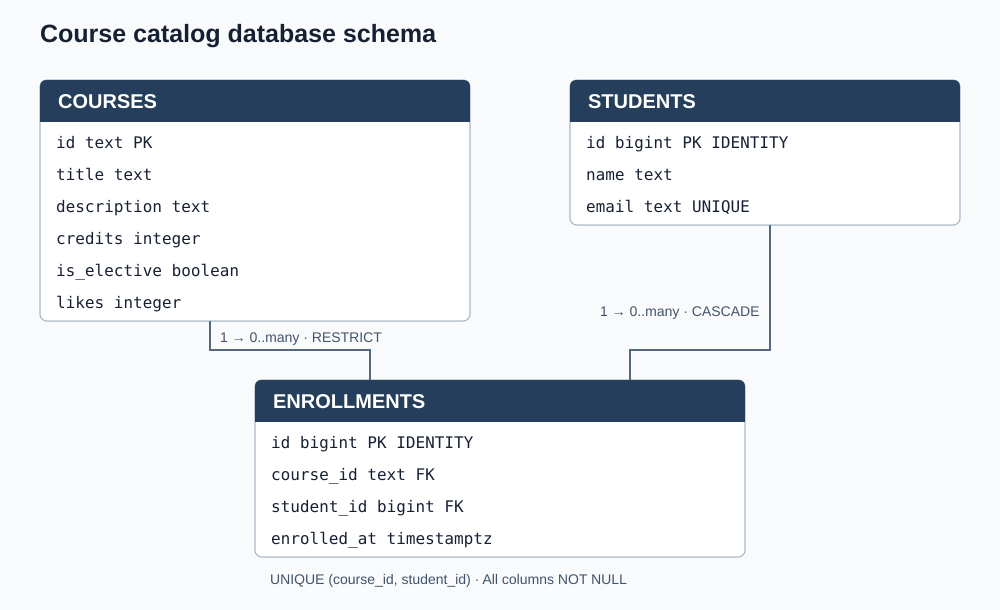
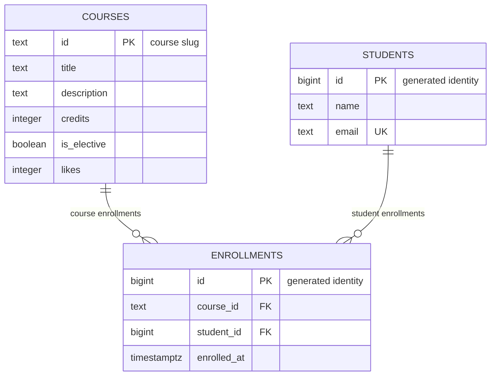

# course-catalog-db

Лабораторная работа 6 — схема каталога курсов в PostgreSQL.
Три таблицы хранят курсы, студентов и записи на курсы. Работа включает
SQL-запросы для API, проверку ограничений, индекса и транзакций.
Проекты `course-catalog-api-lab5` и `course-catalog-lab5` не изменяются.

## Запуск

Требуются PostgreSQL 16 или новее и клиент `psql`. Проверено на PostgreSQL
18.6. Все файлы сохранены в UTF-8. Из корня репозитория подключитесь
к серверу как администратор:

```bash
psql -h localhost -U postgres -d postgres
```

Один раз на пустом сервере выполните:

```sql
CREATE ROLE catalog_app LOGIN PASSWORD 'change-me';
CREATE DATABASE course_catalog OWNER catalog_app;
CREATE DATABASE idx_demo OWNER catalog_app;
CREATE DATABASE norm_demo OWNER catalog_app;
\q
```

`catalog_app` — обычная роль без SUPERUSER и CREATEDB. Пароль `change-me`
предназначен только для учебной локальной базы; реальные пароли в Git не хранятся.
`norm_demo` зарезервирована для необязательного эксперимента по нормализации.

В PowerShell перед запуском установите кодировку:

```powershell
$env:PGCLIENTENCODING = "UTF8"
```

Затем из корня репозитория запустите:

```bash
psql -X -h localhost -U catalog_app -d course_catalog -v ON_ERROR_STOP=1 -f schema.sql
psql -X -h localhost -U catalog_app -d course_catalog -v ON_ERROR_STOP=1 -f seed.sql
psql -X -h localhost -U catalog_app -d course_catalog -v ON_ERROR_STOP=1 -f queries.sql
```

При запросе пароля введите `change-me`. Команды используют стандартный порт 5432;
если сервер работает на другом порту, добавьте `-p НОМЕР` к каждой команде.
Локальные эксперименты этой работы выполнены на порту 55436.

**schema.sql удаляет прежние таблицы и данные этой учебной базы.**
Схема пересоздаётся в одной транзакции. seed.sql загружается после неё;
его повторный запуск без пересоздания таблиц завершится ошибкой уникальности,
при этом вставки откатятся целиком. queries.sql можно запускать повторно:
изменения строк откатываются, но счётчик ID может увеличиться.

Ожидаемые исходные количества: **6 курсов, 3 студента, 6 записей**.
Проверить структуру можно командами `\dt`, `\d courses`, `\d students`
и `\d enrollments` внутри psql.

```text
course-catalog-db/
  schema.sql
  seed.sql
  queries.sql
  experiments/
    constraints.sql
    idx_data.sql
    index.sql
    transactions.sql
  docs/
    schema.svg
  README.md
```

Для повторения опытов после загрузки исходных данных:

```bash
psql -X -h localhost -U catalog_app -d course_catalog -f experiments/constraints.sql
psql -X -h localhost -U catalog_app -d idx_demo -v ON_ERROR_STOP=1 -f experiments/index.sql
psql -X -h localhost -U catalog_app -d course_catalog -f experiments/transactions.sql
```

Ошибки в constraints.sql и transactions.sql преднамеренные: эти сценарии
продолжаются после ошибки, чтобы проверить последующее состояние.
index.sql пересоздаёт таблицы только в idx_demo и отказывается выполнять
эксперимент в другой базе. Для успешной транзакции с двумя подключениями
выполните инструкции в transactions.sql вручную. Затем повторите три
основные команды запуска для восстановления исходного состояния.

## Схема



<details>
<summary>Исходная диаграмма Mermaid</summary>



</details>

Один курс и один студент могут иметь много записей, но каждая запись
относится ровно к одному курсу и одному студенту. Связь студентов и курсов
«многие ко многим» реализована через enrollments; пара `(course_id, student_id)`
уникальна. Имена студентов и сведения о курсах хранятся в своих таблицах.

## Решения при проектировании

- `courses.id` — текстовый slug, уже используемый в URL API: его удобно читать,
  но текстовый ключ занимает больше места, а переименование затрагивает ссылки.
  `students.id` — автоматически выдаваемый bigint: стабильный компактный ключ,
  независимый от изменяемых имени и email; сам номер не описывает студента.
- `RESTRICT` запрещает удалить курс, пока на него есть записи, и защищает
  существующие регистрации. `CASCADE` удаляет регистрации вместе со студентом,
  потому что самостоятельного смысла у них после его удаления нет.
- `timestamptz` хранит однозначный момент времени и отображает его с учётом
  часового пояса подключения; исходное название часового пояса не сохраняется.
  `timestamp` без зоны не задаёт однозначный момент. `text` не вводит
  произвольного ограничения длины и не уступает varchar(n) в производительности;
  необходимые бизнес-ограничения, например длина имени, заданы через CHECK.

## Журнал нарушений ограничений

Эксперименты выполнены на PostgreSQL 18.6 с `\set VERBOSITY verbose`.
Сценарий: [experiments/constraints.sql](experiments/constraints.sql).
Ожидаемые ошибки в этом сценарии являются частью проверки.

| № | Нарушение | SQLSTATE | Ограничение или столбец | Ответ API |
|---|---|---|---|---|
| 1 | NULL в courses.title | `23502` | `courses.title (NOT NULL)` | 422; если пропустила валидация API — 500 |
| 2 | Нулевые credits | `23514` | `courses_credits_check` | 422 |
| 3 | Отрицательные likes | `23514` | `courses_likes_check` | 500 — ошибка кода счётчика |
| 4 | Имя из одного символа | `23514` | `students_name_check` | 422 |
| 5 | Повтор email | `23505` | `students_email_key` | 409 Conflict |
| 6 | Повтор course id | `23505` | `courses_pkey` | 409 Conflict |
| 7 | Повтор пары курс и студент | `23505` | `enrollments_course_id_student_id_key` | 409 Conflict |
| 8 | Несуществующий курс | `23503` | `enrollments_course_id_fkey` | 404 — курс не найден |
| 9 | Несуществующий студент | `23503` | `enrollments_student_id_fkey` | 404 — студент не найден |
| 10 | Удаление курса с записями | `23001` | `enrollments_course_id_fkey` | 409 Conflict |
| 11 | Удаление студента | ошибки нет | `enrollments_student_id_fkey`, CASCADE | 204 при успешном удалении |

При удалении Daniyar внутри транзакции число записей изменилось **6 → 3**;
после `ROLLBACK` восстановилось **6**. Все десять ошибочных команд оставили
таблицы без изменений: 6 курсов, 3 студента, 6 записей.

На PostgreSQL 18 запрет RESTRICT возвращает `23001`; на 16–17 — `23503`.
Для NOT NULL сервер вернул поле `column_name = title`, без имени ограничения.
API должен различать ошибки по SQLSTATE и имени ограничения, а не тексту сообщения.

Pydantic проверяет вход API и позволяет сразу объяснить ошибку пользователю.
Ограничения БД защищают данные при прямом SQL, импорте и обращении других программ;
поэтому проверка длины имени нужна в обоих местах. UNIQUE также защищает от
одновременных запросов, которые могли бы пройти предварительную проверку API.

Счётчики ID могут иметь пропуски: выданное значение не возвращается при ошибке
или откате. Это не означает потерю строки.

## Индекс и EXPLAIN

База `idx_demo`: 500 курсов, 20 000 студентов, 50 000 записей.
Запрос: `SELECT * FROM enrollments WHERE student_id = 777;`.
Измерения получены на PostgreSQL 18.6, Windows, 29 октября 2026 года.
Сценарий повторения: [experiments/index.sql](experiments/index.sql).
Он удаляет индекс перед измерением, так как итоговая схема уже содержит его.

### План до индекса

```text
Seq Scan on enrollments  (cost=0.00..1042.00 rows=3 width=34)
  Filter: (student_id = 777)
```

### План после индекса

```text
Bitmap Heap Scan on enrollments  (cost=4.31..15.59 rows=3 width=34)
  Recheck Cond: (student_id = 777)
  ->  Bitmap Index Scan on enrollments_student_id_idx  (cost=0.00..4.31 rows=3 width=0)
        Index Cond: (student_id = 777)
```

| Показатель | До индекса | После индекса |
|---|---|---|
| Доступ | Seq Scan | Bitmap Heap Scan |
| cost | 0.0..1042.0 | 4.31..15.59 |
| Rows Removed by Filter | 49997 | 0, фильтрация всей таблицы не нужна |
| Execution Time, минимум из 3 | 8.514 ms | 0.082 ms |

Все три замера до: 9.576, 9.114, 8.514 ms; после: 0.228, 0.082, 0.083 ms. Время зависит от компьютера и кэша.

Размер таблицы — 3336 kB, дополнительного индекса — 896 kB. Индекс занимает место и требует обслуживания при INSERT, DELETE и изменении student_id.

Поиск по email:

```text
Index Scan using students_email_key on students  (cost=0.29..8.30 rows=1 width=45)
  Index Cond: (email = 'student777@example.com'::text)
```

Поиск по course_id:

```text
Bitmap Heap Scan on enrollments  (cost=5.19..241.01 rows=100 width=34)
  Recheck Cond: (course_id = 'course-7'::text)
  ->  Bitmap Index Scan on enrollments_course_id_student_id_key  (cost=0.00..5.17 rows=100 width=0)
        Index Cond: (course_id = 'course-7'::text)
```

1. PRIMARY KEY и UNIQUE автоматически создают индексы; FOREIGN KEY на ссылающейся стороне — нет. Для email индекс появился из UNIQUE, для course_id используется первый столбец UNIQUE (course_id, student_id). Для поиска только по student_id в данном эксперименте выбран Seq Scan: составной индекс не дал выгодного плана. В PostgreSQL 18 возможен skip scan по последующим столбцам, но его выбор зависит от статистики и стоимости.
2. Шесть курсов помещаются на одной странице: прочитать её дешевле, чем обращаться к индексу и затем к таблице. На 50 000 строк отдельный индекс позволяет получить только нужные записи.
3. Индекс student_id ускоряет выборку записей одного студента и поиск дочерних строк при каскадном удалении студента.

Проверенный план для маленькой таблицы courses после ANALYZE:

```text
Seq Scan on courses  (cost=0.00..1.07 rows=1 width=100)
  Filter: (id = 'api-design'::text)
```

## Транзакция

Сценарий: новый студент Madina Ospanova и его запись на курс — два INSERT.
Проверка проведена через два независимых подключения к course_catalog;
изоляция сервера — `read committed`.

- В неудачном варианте второй INSERT ссылался на `no-such-course` и вернул
  `23503`, ограничение `enrollments_course_id_fkey`. Транзакция перешла в
  ошибочное состояние; следующий SELECT вернул `25P02` — current transaction
  is aborted. После ROLLBACK число студентов с email `madina@example.com`
  равно 0: первый INSERT тоже отменён.
- В успешном варианте подключение A добавило студента и запись на
  `web-security`, оставив транзакцию открытой. Подключение B до COMMIT
  видело 0 новых студентов и 0 новых записей; после COMMIT — 1 и 1.
  Общие количества стали 4 студента и 7 записей. Обе строки стали видимы вместе.
- Без транзакции при автокоммите первый INSERT сохранился бы отдельно:
  ошибка второго оставила бы студента без записи на курс.

Команды для повторения находятся в [experiments/transactions.sql](experiments/transactions.sql).
Неудачный сценарий выполняется файлом; успешный — пошагово в двух окнах,
как указано в комментариях. После эксперимента выполнены schema.sql и seed.sql,
чтобы восстановить исходные данные. Транзакции следует держать короткими:
до их завершения удерживаются блокировки.

## Самопроверка

| Критерий | Результат |
|---|---|
| Ключи | Да: PRIMARY KEY во всех трёх таблицах, два FOREIGN KEY для связей. |
| Типы | Да: slug — text, автоматические номера — bigint, время — timestamptz, кредиты и лайки — integer, выборность — boolean. |
| Обязательные значения | Да: все столбцы NOT NULL, включая первичные ключи; значения по умолчанию false, 0, now(). |
| Ограничения | Да: credits > 0, likes >= 0, char_length(name) >= 2, уникальные email и пара курс–студент; правила совместимы с валидацией API. |
| Удаление | Да: RESTRICT для курса, CASCADE для студента; оба поведения проверены. |
| Нормализация | Да: данные курса и студента не дублируются в записях, списков в ячейках нет; связь многие ко многим вынесена отдельно. |
| Индексы и имена | Да: course_id покрыт первым столбцом составного UNIQUE, student_id — отдельным индексом; используется snake_case, лишний индекс course_id не создаётся. |

Проверка с нуля: schema.sql, seed.sql и queries.sql выполнены с
`ON_ERROR_STOP=1`, затем повторены на существующей схеме. Все запросы проходят
без ошибок; исходные количества остаются 6 / 3 / 6, likes у api-design — 11.
Первая страница обязательных курсов: modern-frontend, web-security,
backend-fastapi; вторая: databases-postgresql. Статистика записей:
ai-integration — 3, modern-frontend — 2, backend-fastapi — 1,
api-design, databases-postgresql и web-security — 0.
